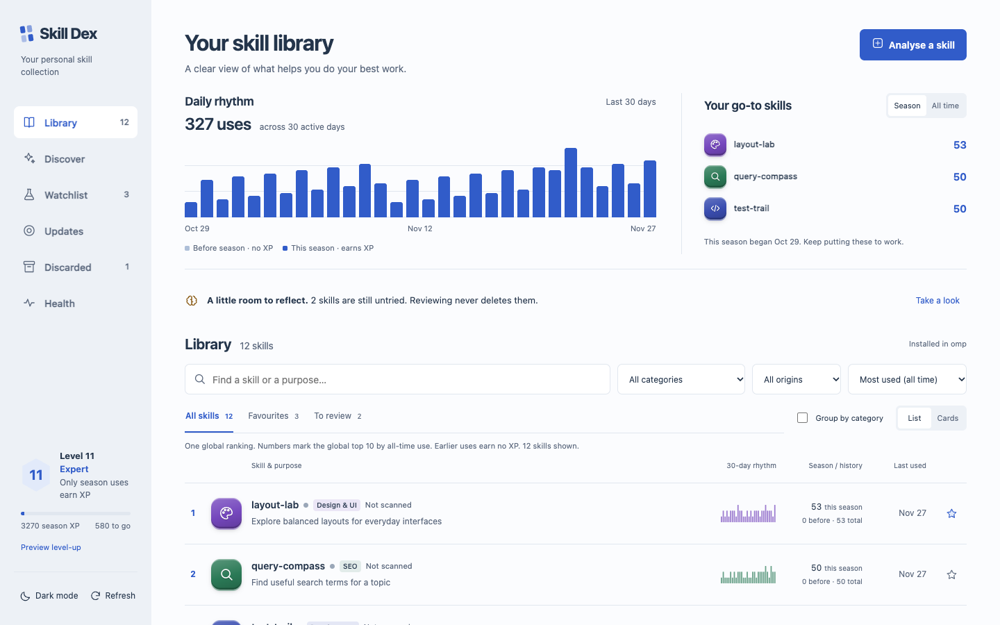

# Skill Dex

A local command center for your [omp](https://github.com/can1357/oh-my-pi) agent skills. It lists every skill installed on your Mac,
shows how much each one is used, flags security findings, keeps a watchlist of skills you are evaluating, and can run an
analysis of a skill before you install it. Your catalog and usage stay on your machine; optional analysis and discovery integrations are described under Privacy.



The screenshot uses made-up skills and simulated activity, not a real user's catalog.

## Requirements

- macOS (the double-click launcher is macOS-only).
- [Node.js](https://nodejs.org) 24 or newer; verified locally with **24.21.0**.
- A browser.
- [omp](https://github.com/can1357/oh-my-pi), with skills installed in its usual folders. The catalog can be browsed without the command-line binary; running "Analyze skill" and background descriptions requires it and a configured OpenAI account.
- Optional: [GitHub CLI (`gh`)](https://cli.github.com) and `gh auth login` for authenticated Discover searches. Without a login, Discover uses public repository search with lower limits. Updates uses `git`, not a GitHub login; `git` must be installed to check source repositories.
- Optional: Python 3.12–3.15 and SkillSpector for security scans and applying skill updates (setup below).

## Install

```sh
git clone <this repository's URL> skill-dex
cd skill-dex
```

No dependencies to install.

### Optional security scanner

Install [SkillSpector](https://github.com/NVIDIA/skillspector) into the local virtual environment expected by the app:

```sh
python3 -m venv .venv-skillspector
.venv-skillspector/bin/python -m pip install skillspector
```

Security checks use static mode (`--no-llm`). The catalog still works without the scanner, but applying updates is blocked until their security check can run. A first install downloads the scanner and its dependencies; dependency checks may contact `api.osv.dev`.

### Option A: double-click app (macOS)

```sh
macos/build-app.sh            # writes ~/Applications/Skill Dex.app
macos/build-app.sh ~/Desktop  # or choose another folder
```

The app remembers where this repository is (`Skill Dex.app/Contents/Resources/repo-path.txt`). If you move the repository,
rebuild the app or edit that file. On first launch macOS may ask you to confirm opening an app that is not from the App Store.

### Option B: from a terminal

```sh
./lanzar.sh                   # scans, starts the server in the background, opens the browser
# or, in the foreground:
node scan.mjs && node server.mjs   # then open http://localhost:4173
```

The server only listens on `127.0.0.1` and stops by itself when you close the browser tab. Opening the app again while it is running just opens a new tab.

## Configuration

Skill Dex reads skills from `~/.omp/agent/skills` and `~/.omp/agent/managed-skills`, the `.omp/skills` folder of each project it finds under `~/Developer` or in your omp sessions, and usage counts from your omp sessions in `~/.omp/agent/sessions` (all read only).

Everything Skill Dex writes goes in a **data folder**:

| Setting | Meaning | Default |
| --- | --- | --- |
| `SKILLDEX_DATA` | data folder | a `Seguimiento` folder next to the repository folder if it exists, otherwise `~/Library/Application Support/Skill Dex` (when started with `lanzar.sh`) |
| `PORT` | local port | `4173` |
| `OMP_BIN` | path of the `omp` binary | looked up in `~/.local/bin`, Homebrew, then `PATH` |
| `SKILLDEX_ANALYSIS_SKILL` | an installed skill whose analysis steps "Analyze skill" follows (same as `analysis_skill` in `config.json`) | none: built-in steps |
| `SKILLDEX_HOME` | repository folder used by the app (overrides `repo-path.txt`) | the built-in path |

Set them as environment variables, or put `KEY=value` lines in a `skilldex.conf` file next to `lanzar.sh` (git-ignored). Generated files (`web/data.js`, `cache/`) are also git-ignored. With an empty data folder the app opens with an empty watchlist and lists only your installed skills.

For example, create a private `skilldex.conf` (do not commit it):

```sh
SKILLDEX_DATA="$HOME/Library/Application Support/Skill Dex"
PORT=4173
```

`lanzar.sh` reads this file. When starting `node` directly, export the same environment variables yourself. `GH_BIN` can override the GitHub CLI binary; `SKILLSPECTOR_BIN` overrides the scanner used for Updates.

Files in the data folder, all plain JSON or Markdown you can edit by hand (each is created when first needed):

| File | What it holds |
| --- | --- |
| `watchlist.json` | skills you are evaluating or discarded, with the reasons |
| `analisis/<id>.md` | analysis reports |
| `config.json` | `{"inicio": "YYYY-MM-DD"}`: start of the current season (only uses since then earn XP); optional `"analysis_skill": "<skill name>"` |
| `marks.json` | your favourites: `{"favourites": [ids]}` |
| `skills-meta.json` | categories and icons, see below |
| `short-descriptions.json` | one short English line per skill id |
| `pair-advice.json` | advice for similar skill pairs |
| `security-triage.json` | security findings reviewed by hand |
| `updates-state.json`, `backups/` | skipped update versions, and copies saved before each update |

### Categories and icons: `skills-meta.json`

```json
{
  "_categories": {
    "Writing": { "name": "Writing", "color": "#BF6A10", "dark": "#D27F25", "icon": "feather", "keywords": "copy|writ|blog" },
    "Other":   { "name": "Other", "color": "#5A6873", "dark": "#6F7F8B", "icon": "box", "fallback": true }
  },
  "my-skill": { "category": "Writing", "icon": "editLines" },
  "shared-notes": { "category": "Other", "icon": "box", "update_source": "none", "from": "A contributor" }
}
```

- `_categories` (optional) replaces the built-in list (SEO, Marketing & ads, Performance & quality, Design & UI, Development, Other). The key is what is stored in the watchlist and in analysis results; `name` is shown; `color`/`dark` are the light and dark mode colours; `keywords` is a regular expression; the `fallback` category takes whatever matches nothing.
- An entry per skill (by id, or folder name for project skills) sets its category and icon. A skill without an entry gets the first category whose keywords match its name, then its description, otherwise the fallback.
- A skill without an icon gets one from words of its description, else its category's icon. Icon names are the keys of `P` in `web/catalog.js`.
- `update_source: "none"` declares that a skill has no update source, even if its folder records an old source. Updates never checks it and displays `From <from>, no update source`; with no `from` (or an empty value), it displays `No update source`. `from` is optional attribution kept only in your local data. Other skills use their `ORIGEN.md` repository and commit, when present.

## Privacy

- Scanning the catalog and usage is local and sends no telemetry. The server binds to `127.0.0.1` and rejects requests from other origins.
- Your skills list, usage counts, watchlist, reports and favourites stay on your Mac, outside the repository, in the data folder (favourites also keep a copy in the browser's local storage).
- Discover (GitHub search) and Updates (reading a skill's source) go online only when you use them.
- "Analyze skill" launches your local `omp` agent with an OpenAI model; the skill text it analyzes is sent to that model by `omp`, under your own omp account.
- Before publishing a fork, run `node tools/privacy-check.mjs --exclude spec/`: it scans tracked and non-ignored new files, including `spec-public/`, for home paths, e-mails, tokens, session paths and installed skill ids. Add private names, project names and client names to git-ignored `privacy.local.txt`, one per line; the checker and specification exporter load these optional terms at runtime. Keep that file private. The MIT copyright's public account handle is intentional attribution.

## Tools

- `node tools/privacy-check.mjs [--dir PATH] [--exclude PREFIX]`: personal-data scan described above.
- `node tools/export-public-spec.mjs`: writes a cleaned copy of the private `spec/` requirements package to versioned `spec-public/`, omitting owner quotes and replacing local private terms, paths and installed skill ids. Run it while the private package is available, then run the privacy check.
- `node tools/regenerate-reports.mjs <watchlist id>...`: asks the running app to write new reports for those entries, one analysis at a time (each uses quota; an entry keeps its status). `--status` shows the queue.
- `node --test test/*.test.mjs updates.test.mjs`: the automated tests (no network, no analysis, only temporary folders).
- `node tools/demo/make-demo.mjs`: rebuilds the two README screenshots using an isolated temporary home, fictional skills and 30 days of simulated usage. Requires Google Chrome (override its path with `CHROME_BIN`); the demo listens only on `127.0.0.1:4182`, disables agent/GitHub CLI execution, stops its processes and removes its temporary files on exit. The normal catalog and local data are untouched.

## Specification

[`spec-public/`](spec-public/) contains the sanitized requirements snapshot. The full working specification is private and is not needed to run or test the app.

## Contributing

Keep changes focused, use fictional fixtures in temporary directories, and run the tests and privacy check before proposing a change. Never include skills, session logs, watchlists, reports, local settings or credentials from your own machine.

## License

[MIT](LICENSE).
